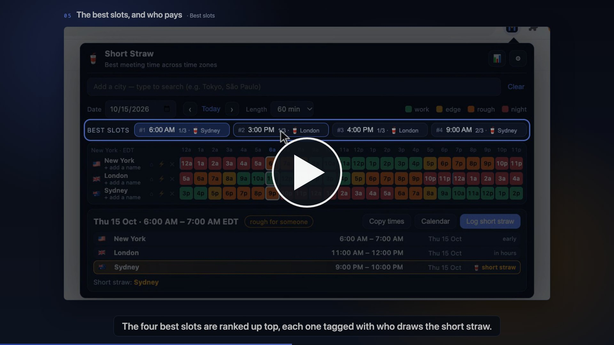

# Short Straw — global meeting planner

[](https://ericediger.github.io/short-straw/media/short-straw-explainer.mp4)

**[▶ Watch the 2-minute explainer](https://ericediger.github.io/short-straw/media/short-straw-explainer.mp4)** · **[Try the live demo](https://ericediger.github.io/short-straw/demo.html)** — the real popup, pre-loaded with a fictional
three-city team. Nothing is saved anywhere but your own browser, and no key or account is needed.

A Chrome extension that finds the least-painful meeting time across time zones, and is
honest about who's taking the hit when there isn't a painless one.

Plain HTML/CSS/JS. No build step, no bundler, no network calls, no accounts.

## Install (unpacked)

1. Open `chrome://extensions`
2. Turn on **Developer mode** (top right)
3. Click **Load unpacked** and choose this folder (or run `./make-dist.sh` and choose
   `dist/`, which holds only the extension files)
4. Pin the 🥤 icon to the toolbar

To pick up code changes later, hit the ↻ reload button on the extension's card.

## Using it

- **Add cities** — type in the search box (city, country, or IANA zone). ~140 major
  business hubs are built in. Your own city is added automatically on first run.
- **The grid** — one row per city, 24 columns for one day in the *reference* city
  (marked ⌂). Colours: green = inside working hours, amber = an hour either side,
  orange = well outside, red = the middle of the night. Diagonal hatching = weekend.
  Click any column to select that slot.
- **Best slots** — the four highest-scoring hours, each labelled with how many people
  are inside working hours and who draws the short straw.
- **The detail card** — everyone's local time and date for the selected slot, with the
  short straw called out. **Copy times** puts a paste-ready block on the clipboard;
  **Calendar** opens a pre-filled Google Calendar event in a new tab.

### Per-person controls (hover a row)

| Button | Meaning |
|---|---|
| ⌂ | Make this the reference city — the grid's columns and the date follow it |
| ⚡ | Flexible: widens this person's tolerance by 1.5 h either side |
| ✕ | Remove |

Click *+ add a name* under a city to attach a person's name — it shows up in the copied
summary and in the tally.

### Short straw + fairness

When no slot works for everyone, the person with the worst local time draws the short
straw. Hit **Log short straw** to record it. With **Rotate the pain** on (Settings),
logged hits push the ranking away from slots that punish the same person again — so
after a couple of meetings the 11 p.m. call moves to someone else. 📊 shows the tally.

### Settings (⚙)

Working hours, 12/24-hour clock, weekend penalty, and pain rotation. All settings,
cities, and the tally persist in `chrome.storage.local`.

## How the scoring works

For each candidate hour, every person is scored at the meeting's start and end (whichever
is worse): 0 inside working hours, 2 within an hour of the edge, 6 within three hours,
12 beyond that, 25 between 10 p.m. and 6 a.m., +12 for a weekend. The slot score is the
sum, plus a nudge for the worst individual, plus the fairness adjustment. Lowest wins.

DST is handled correctly — every slot is evaluated as a real UTC instant and converted
per-zone with `Intl.DateTimeFormat`, so a date in March or November behaves properly.

## Files

```
manifest.json       MV3 manifest (only permission: storage)
popup.html/css/js   the whole UI
cities.js           ~140 cities with IANA zones
icons/              generated PNGs
demo.html/css/js    the live demo: a mock browser window around the real popup, with a fictional team
media/              the explainer video and its poster frame
make-dist.sh        copies just the extension files into dist/ (ignored by git)
```

## Local preview without Chrome

`popup.html` runs standalone in any browser — it falls back to `localStorage` when
`chrome.storage` isn't there. Serve the folder with any static server (e.g.
`python3 -m http.server`) and browse to `popup.html` for the bare popup, or to `demo.html`
for the same popup inside a mock browser window with the fictional demo team.

The popup never scrolls: Chrome caps a popup at 800×600, so the layout sizes itself to its
content, switches the detail list to two columns when the team is long, and scales down as a
last resort (`fitToPopup` in `popup.js`).
